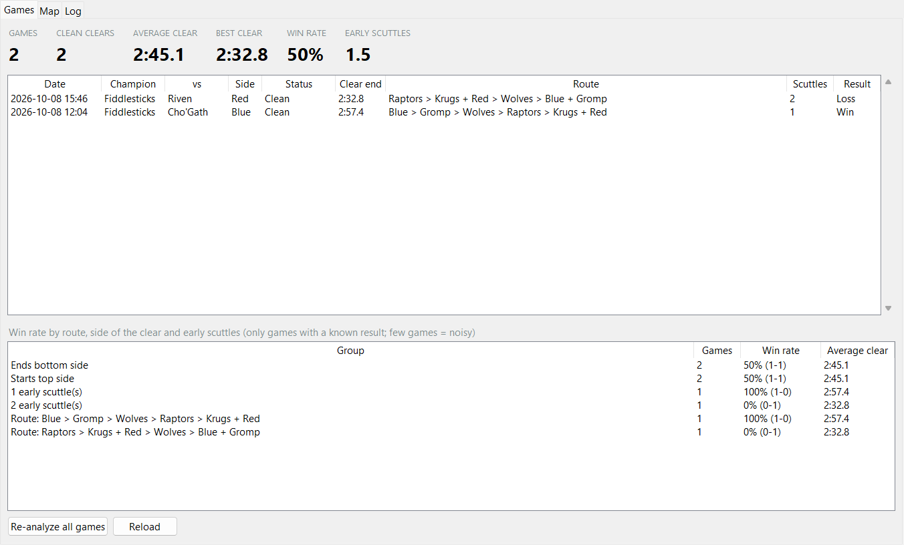
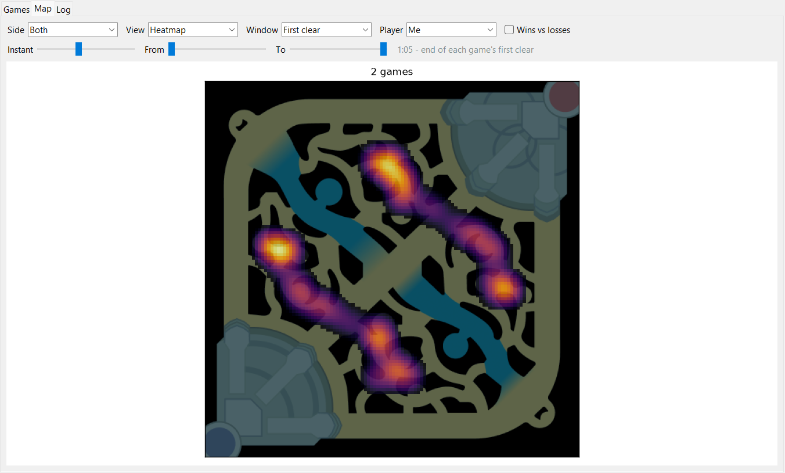

# Jungle Clear Tracker

**¿Cuánto tardas de verdad en tu primer clear?**
Tiempo exacto de cada campamento, orden, scuttles y un mapa de tus primeros 7 minutos, en cada partida de jungla, de forma automática.

[English](README.md) · **Español**

## Qué hace

- ⏱️ **Tiempo del primer clear** con ~0,5 s de precisión, y cuándo murió cada campamento
- 🧭 **Orden de campamentos**, incluidos los que haces a la vez (`Krugs + Red`)
- 🦀 **Scuttles al inicio** (0, 1 o 2) y de qué lado
- 📊 **Winrate** por ruta, por el lado en que empiezas o terminas y por scuttles
- 🗺️ **Mapa**: calor, posiciones en cualquier segundo o recorridos, tuyos o del jungla rival, victorias contra derrotas
- 🤖 **Sin tocar nada**: funciona en segundo plano y puede arrancar con Windows

## Cómo funciona

Lo que pasa al pulsar **Start** (la barra de estado muestra siempre el paso actual):

1. **Espera al cliente de LoL** y lo mira cada pocos segundos.
2. **Empieza una partida.** Al cargar comprueba tres cosas: que juegas tú (no estás de espectador), que llevas **Castigo** y que la partida no pasa de 1:30. Si falla alguna, apunta el motivo en el Log y no hace nada más con esa partida.
3. **Graba en directo hasta el minuto 7.** Varias veces por segundo: tu **oro**, CS, nivel, muertes y objetos, y el CS y nivel del jungla rival. Cada monstruo es un salto de oro, así que los tiempos son exactos. En el 7:00 deja de grabar; la partida no se toca.
4. **Espera al final de la partida** para guardar el resultado (victoria o derrota).
5. **Abre el replay** cuando llevas 10 s fuera de cola: lo descarga, lo abre, fija la cámara sobre el mapa y lo reproduce de 0:00 a 7:00 a x4 (~2 min), grabando la **posición** de cada campeón.
   - Si entras en cola o en selección mientras tanto, para, cierra el replay y lo reintenta más tarde (hasta 3 veces, también tras reiniciar la app).
   - Si el replay no está disponible, la partida se queda con los datos en directo (tiempos, pero sin ruta ni mapa).
6. **Cierra el replay**. Solo si hay un replay abierto y no estás en partida.
7. **Analiza la partida**: tiempo del primer clear, orden de campamentos, scuttles, estado y resultado. Se actualizan las pestañas **Games** y **Map** y se añade la fila a `summaries.csv`.

Desde que acaba la partida hasta tener el resultado: unos 2–3 minutos, si te quedas fuera de cola.

Solo usa las APIs locales oficiales del juego. No lee memoria ni tráfico de red, y no muestra nada durante tus partidas.

## Empezar

1. Descarga `JungleClearTracker.exe` desde [Releases](../../releases) (o ejecútalo desde el código: `pip install -r requirements.txt` y `python run.py`).
2. Ábrelo: el **Setup check** encuentra tu carpeta de LoL y activa la Replay API del juego con un clic.
3. Elige una carpeta de datos, pulsa **Start** y juega.

> [!NOTE]
> El exe no está firmado, así que SmartScreen o tu antivirus pueden avisar.

## A tener en cuenta

- Las reglas se ajustaron con partidas reales de Fiddlesticks; con otros campeones puede necesitar pequeños ajustes.
- Los valores que dependen del parche (posiciones de campamentos, aparición del scuttle, umbrales de oro) están en [`jct/patch.json`](jct/patch.json).
- Solo se pueden analizar las partidas grabadas a partir de ahora: los replays solo se abren en el parche en que se jugaron.
- Tus datos se quedan en la carpeta que elijas (capturas, `summaries.csv`, log).

---

Jungle Clear Tracker isn't endorsed by Riot Games and doesn't reflect the views or opinions of Riot Games or anyone officially involved in producing or managing Riot Games properties. Riot Games, and all associated properties are trademarks or registered trademarks of Riot Games, Inc. · Minimapa de Data Dragon (Riot) · [Licencia MIT](LICENSE)
